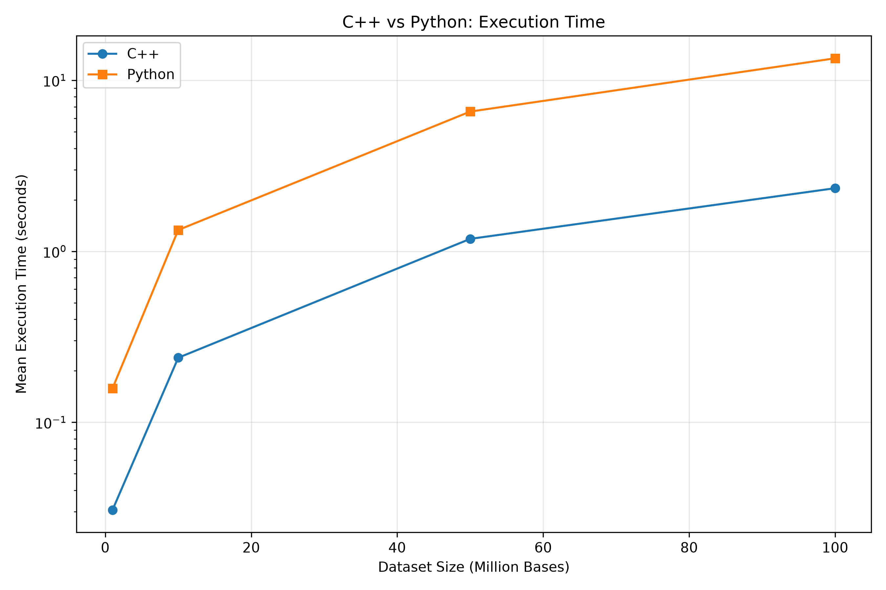
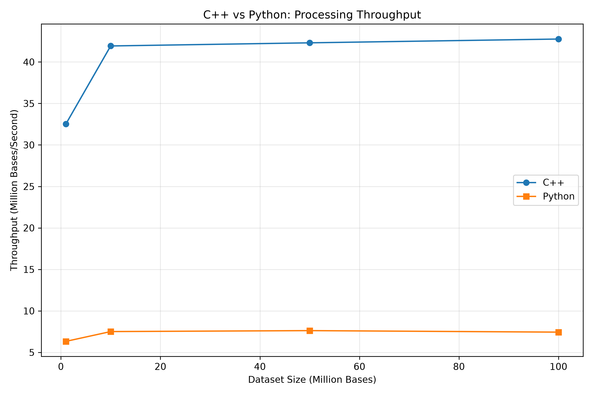
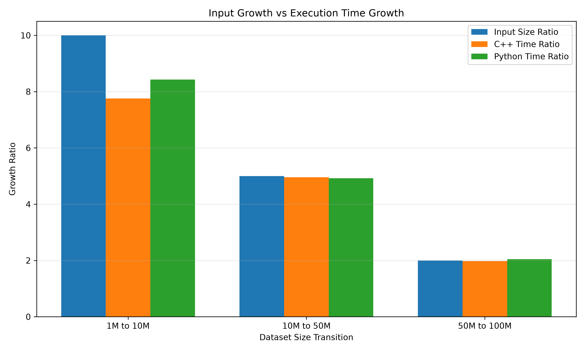
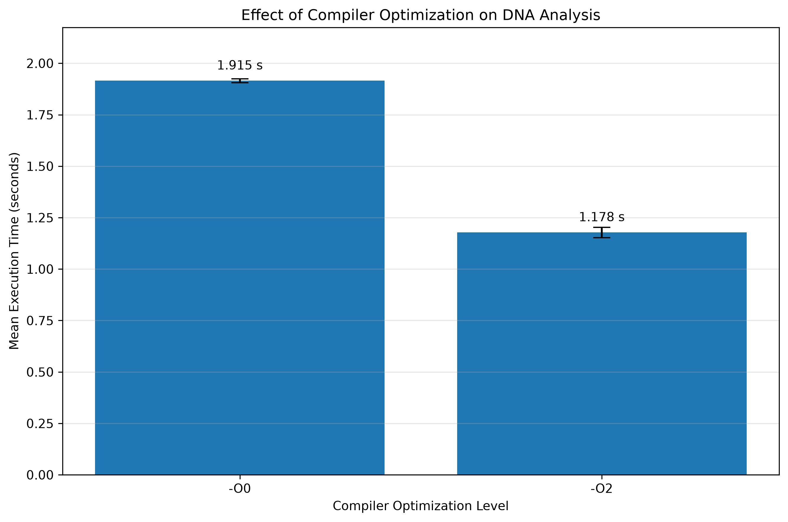

# C++ vs Python: DNA FASTA Benchmark

A practical comparison of C++ and Python for analysing DNA sequences stored in FASTA format.

## 1. Project Overview

This project evaluates the execution time, processing throughput, and scalability of C++ and Python implementations for DNA FASTA sequence analysis.

Both programs process FASTA files line by line rather than loading the entire sequence into memory. They count nucleotide symbols A, T, G, C, N, and other characters, and calculate the total number of canonical bases and GC content.

**Research question:**

How do C++ and Python compare in execution time, processing throughput, and scalability when analysing DNA sequences stored in FASTA format?

## 2. Objectives

- Implement DNA FASTA analysis in C++ and Python.
- Compare execution time across different dataset sizes.
- Calculate processing throughput in million bases per second.
- Examine how execution time changes as dataset size increases.
- Investigate the effect of C++ compiler optimization using `-O0` and `-O2`.
- Provide reproducible scripts and benchmark results.

## 3. Features

- FASTA header handling.
- Counting of A, T, G, C, N, and other symbols.
- Calculation of canonical base count.
- Calculation of GC content.
- Line-by-line sequence processing.
- Benchmark analysis and plotting scripts.

## 4. Project Structure

```text
dna-fasta-benchmark/
├── datasets/
│   └── human_mitochondrial.fasta
├── figures/
│   ├── compiler_optimization_50m.png
│   ├── execution_time_vs_dataset.png
│   ├── scaling_ratios.png
│   └── throughput_vs_dataset.png
├── results/
│   ├── analysis/
│   │   ├── benchmark_analysis.csv
│   │   └── optimization_50m.csv
│   └── raw/
│       └── Hyperfine benchmark results (JSON and text)
├── scripts/
│   ├── analyze_benchmarks.py
│   ├── generate_datasets.sh
│   ├── plot_benchmarks.py
│   ├── plot_optimization.py
│   └── scaling_analysis.py
└── src/
    ├── dna_benchmark.cpp
    └── dna_benchmark.py
```

## 5. Requirements

### Software

- Linux or another Unix-like operating system.
- GCC compiler supporting C++17.
- Python 3.
- Matplotlib (for generating figures).
- Hyperfine (for benchmarking).

### Python dependency

Install Matplotlib using:

```bash
python3 -m pip install matplotlib
```

Hyperfine is required only if you want to repeat the benchmark experiments.

## 6. Compilation and Usage

### Compile the C++ program

From the repository root:

```bash
mkdir -p build

g++ -O2 -std=c++17 -Wall -Wextra \
    src/dna_benchmark.cpp \
    -o build/dna_bench
```

### Analyse a FASTA file using C++

```bash
./build/dna_bench analyze datasets/human_mitochondrial.fasta
```

### Analyse a FASTA file using Python

```bash
python3 src/dna_benchmark.py datasets/human_mitochondrial.fasta
```

### Generate random FASTA datasets

For users who want to reproduce the experiments:

```bash
./scripts/generate_datasets.sh
```

This script generates 1M, 10M, 50M, and 100M base random FASTA datasets under `datasets/generated/`.

## 7. Experimental Methodology

### Dataset sizes

Random DNA FASTA datasets were used to evaluate performance at different input sizes.

| Dataset | Sequence length |
|---|---:|
| 1M | 1,000,000 bases |
| 10M | 10,000,000 bases |
| 50M | 50,000,000 bases |
| 100M | 100,000,000 bases |

A human mitochondrial DNA sequence (NC_012920.1) was also analysed as a biological reference dataset.

### Benchmark procedure

- C++ and Python implementations were executed on the same datasets.
- Hyperfine was used to measure execution time.
- Each main dataset benchmark was repeated 10 times.
- A separate 20-run repeat experiment was performed for the 50M dataset.
- Mean, median, and standard deviation were calculated.
- Processing throughput was calculated in million bases per second.

The reported execution time includes program startup, file reading, sequence parsing, nucleotide counting, calculations, and output generation.

### Compiler optimization experiment

The C++ implementation was compiled using two optimization levels:

- `-O0`: Compiler optimization disabled.
- `-O2`: Compiler optimization enabled.

Both executables were benchmarked using the 50M dataset over 20 runs.

## 8. Benchmark Results

### C++ vs Python execution time

The following table presents the mean execution time measured across 10 runs for each dataset.

| Dataset | C++ mean (s) | Python mean (s) | C++ speedup |
|---|---:|---:|---:|
| 1M | 0.03075 | 0.15809 | 5.14x |
| 10M | 0.23850 | 1.33210 | 5.59x |
| 50M | 1.18184 | 6.56098 | 5.55x |
| 100M | 2.33846 | 13.44318 | 5.75x |

For the tested implementations and experimental environment, C++ consistently achieved lower execution times than Python.

### Compiler optimization results

The 50M dataset was used to compare the two C++ compiler optimization levels.

| Optimization | Mean time (s) | Median time (s) |
|---|---:|---:|
| -O0 | 1.915354 | 1.915416 |
| -O2 | 1.177912 | 1.173259 |

The `-O2` executable was approximately 1.63 times faster than the `-O0` executable in this experiment.

Mean execution time decreased by approximately 38.51% with `-O2`.
**Note:** These results apply to the specific implementations, compiler, datasets, and hardware used in this experiment. They should not be interpreted as a universal
 performance comparison between C++ and Python.

## 9. Performance Analysis and Discussion

### Execution time

C++ recorded lower mean execution times than Python across all four dataset sizes.

The observed speedup ranged from approximately 5.14x to 5.75x for the tested datasets.

### Processing throughput

The average processing throughput increased from the 1M dataset to larger datasets and then became relatively stable.

| Dataset | C++ throughput (million bases/s) | Python throughput (million bases/s) |
|---|---:|---:|
| 1M | 32.52 | 6.33 |
| 10M | 41.93 | 7.51 |
| 50M | 42.31 | 7.62 |
| 100M | 42.76 | 7.44 |

### Scalability

Execution time increased approximately in proportion to dataset size for both implementations at larger input sizes.

This behaviour is consistent with the expected O(n) time complexity of scanning a sequence of n bases.

### Compiler optimization

The `-O2` compiler optimization level reduced the mean execution time compared with `-O0` in the 50M experiment. This demonstrates the effect of compiler optimization on this particular C++ implementation.

## 10. Limitations

This experiment has several limitations:

- Benchmarking was performed on a single laptop, so results may differ on other hardware.
- Only one C++ and one Python implementation were evaluated.
- Randomly generated DNA sequences may not represent the full complexity of biological sequences.
- Execution time includes file I/O and program startup, not just nucleotide counting.
- The C++ and Python implementations have minor differences in whitespace handling.
- No parallel processing or multithreading was evaluated.
- Results may be affected by operating system activity and system load during benchmarking.

Therefore, the findings should be interpreted within the scope of the experimental setup.

## 11. Experimental Environment

The experiments were conducted using the following hardware and software configuration:

| Component | Specification |
|---|---|
| Laptop | Dell Vostro 2420 |
| Processor | Intel Core i3-3110M @ 2.40 GHz |
| CPU cores | 2 cores / 4 threads |
| RAM | 4 GB |
| Storage | HDD |
| Operating system | Linux Mint |
| C++ compiler | GCC 13.3.0 |
| C++ standard | C++17 |
| Python | 3.14.9 |
| Benchmarking tool | Hyperfine 1.18.0 |
| Plotting library | Matplotlib 3.11.2 |

## 12. Benchmark Visualizations

The following figures summarize the experimental results.

### 1. Execution Time Comparison



Comparison of mean execution time between C++ and Python across different FASTA dataset sizes.

### 2. Processing Throughput



Comparison of processing throughput in million bases per second.

### 3. Scaling Analysis



Comparison of execution time growth relative to increasing dataset sizes.

### 4. Compiler Optimization



Comparison of C++ execution time using `-O0` and `-O2` compiler optimization levels. Error bars represent standard deviation.

## 13. Data Sources and References

### Biological reference dataset

The human mitochondrial DNA sequence used in this project was identified by the following accession:

- **Organism:** Homo sapiens
- **Sequence:** Complete mitochondrial genome
- **NCBI accession:** NC_012920.1
- **Database:** NCBI Nucleotide

**Data source:** [NCBI Reference Sequence NC_012920.1](https://www.ncbi.nlm.nih.gov/nuccore/NC_012920.1)

### Synthetic datasets

Random DNA FASTA datasets containing 1 million, 10 million, 50 million, and 100 million bases were generated using the C++ dataset-generation program included in this repository.

These synthetic datasets were used for controlled performance benchmarking.

### Benchmarking and software references

- [Hyperfine – Command-line Benchmarking Tool](https://github.com/sharkdp/hyperfine)
- [GCC – GNU Compiler Collection](https://gcc.gnu.org/)
- [Python Documentation](https://docs.python.org/3/)
- [Matplotlib Documentation](https://matplotlib.org/stable/)

## 14. Conclusion

This project compared C++ and Python implementations for analysing DNA sequences stored in FASTA format.

Across the four tested dataset sizes (1M, 10M, 50M, and 100M bases), the C++ implementation achieved lower mean execution times than the Python implementation, with observed speedups ranging from approximately 5.14x to 5.75x.

The throughput analysis showed relatively stable processing rates for larger datasets in both implementations. The compiler optimization experiment also demonstrated that compiling the C++ program with `-O2` improved performance compared with `-O0` for the tested 50M dataset.

Overall, this project provided practical experience in:

- DNA sequence analysis and FASTA file processing.
- C++ and Python programming for bioinformatics.
- Performance benchmarking and statistical analysis.
- Compiler optimization.
- Data visualization and reproducible computational experiments.

The results provide an implementation-specific comparison and a foundation for further experiments involving larger biological datasets, additional programming languages, and optimized sequence-processing algorithms.

---

*This project was developed as an independent bioinformatics learning and benchmarking project.*
